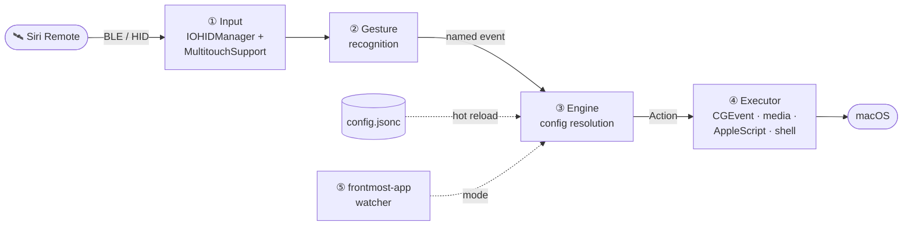
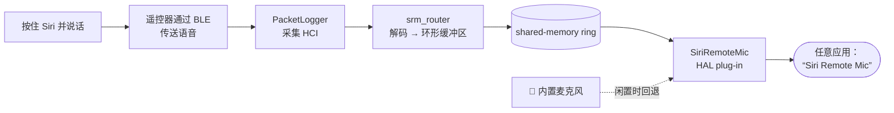

<div align="center">


# 🛰️ SiriRemoteForge

### 十三个按键，含义由你定义。

[](LICENSE)
&nbsp;
&nbsp;
&nbsp;
&nbsp;

*抽屉里的 Apple TV 遥控器已经有精巧的触控表面和十三个按键。*
*这个项目把它变成 Mac 控制器：每个按键的作用由**你**决定，并能随当前应用改变。*
*如果你愿意尝试，它甚至可以变成麦克风。*

</div>

---

> **简要说明**——将所有按键、点击环、触控板和滑动映射到任意操作；让一个按键最多承担六种含义；用图层切换整台遥控器的布局；通过触控表面控制光标；编辑**一个热重载文件**即可重新配置整台设备，无需打开设置界面。

```jsonc
// 返回键：轻点删除；按住半秒关闭窗口；再多按一会儿退出应用。
// 每个阶段都可单独设置延迟。
"button.menu":       { "action": "keystroke", "keys": "delete" },
"button.menu.hold":  { "action": "closeWindow", "after": 0.5 },
"button.menu.hold2": { "action": "applescript", "after": 1.2, "script": "…" },

// …但在浏览器里，“返回”就是返回上一页。
"browser": {
  "button.menu": { "action": "keystroke", "keys": "cmd+[" }
}
```

保存文件后立即生效，无需重启、重新连接或点击设置界面。这也意味着代理或脚本只需编辑一个文件，就能重新配置整台设备。

**功能一览**

- 所有输入都可重新映射：按键、点击环、触控板、滑动和双指轻点。
- 一个按键最多有六种含义：轻点、双击、三击以及最多三个带独立延迟的长按阶段。屏幕卡片会显示此刻松开将执行什么；越过最后一个阶段继续按住则会取消。
- 每个应用可使用沿继承链回退的配置；**图层**可一次切换整台遥控器的布局（按住时临时生效，或切换为常驻图层）。
- 触控表面可控制光标，支持可调加速、iPod 式圆周滚动、锁定拖动、摇动查找光标和按压点击。
- 还提供径向应用启动器、带动画的桌面切换、窗口控制、亮度调节，以及带可点击遥控器图示的原生设置应用。

> **适用范围。**仅支持 macOS，并使用私有框架（MultitouchSupport、SkyLight）访问触控板和桌面空间。因此当前构建未启用 App Sandbox，采用直接分发，而非通过 Mac App Store；常规沙盒分发需要受支持的公开输入 API 和 entitlement 路径。你可以自行构建，或在有 Beta 版本时从 GitHub Releases 下载。发布构建使用 ad-hoc 签名，未经 Apple 公证；首次打开时需右键并选择“打开”。这是面向进阶用户的工具，会请求所需的辅助功能和输入监控权限。

---

## 功能说明

- **所有操作都能重新映射。**按键（Back/Menu、TV、Siri、播放/暂停、静音、音量±、电源）、点击环（上/下/左/右和中心）、单指滑动及双指轻点都可映射到任意操作。
- **触控板控制光标。**遥控器触控表面可控制鼠标指针，支持可调速度、稳定性死区、基于速度的指针加速、按下后冻结移动以实现点击、轻点点击，以及 iPod 式**圆周滚动**（手指沿外圈画圈即可滚动）。
- **按应用配置。**最前端应用决定当前*模式*（例如浏览器或终端模式）；绑定会沿 `inherits` 继承链逐级回退到全局默认值，然后回退到遥控器原生行为。
- **图层。**按键可切换一个**图层**（类似键盘层）：轻点可开关常驻图层，按住则临时启用。图层可与应用模式组合，同一图层在不同应用里可以有不同用途。屏幕 HUD 会确认切换状态。
- **多阶段长按**（`.hold` / `.hold2` / `.hold3`，松开时选择）、**多次轻点**（`.double` / `.triple`）和**按住连发**（按住期间自动重复按键）。
- **其他功能：**电源键可调暗所有显示器，*而不是让 Mac 睡眠或锁定*（仅对遥控器屏蔽 macOS 自身的电源键快捷行为，不影响 Mac 实体电源键）；再次触摸可恢复亮度。HUD 会提示遥控器连接/断开。摇动光标可闪烁显示“查找指针”提示。macOS **桌面空间**切换带动画。
- **两种配置方式：**手动编辑 `~/.config/siriremote/config.jsonc`（保存后热重载），或使用内置**设置**应用：Tuning 页提供滑块，Layout 页提供遥控器图示和可点击编辑的映射表，支持按应用配置图层。

---

## 工作原理



发布应用由两部分 Swift 代码组成，另外包含独立的虚拟麦克风子系统和较早的 DriverKit 实验：

- **`SiriRemoteCore/`**——纯 Swift、无外部依赖且经过单元测试的引擎（SwiftPM 包）。负责配置模型（JSONC 解析、`Action` 枚举、按应用模式和 `inherits` 解析、图层、多阶段长按阈值）、配置**写回**（将 `Config` 重新序列化成 JSONC，使 UI 编辑可往返保存）以及圆周滚动计算。不依赖 AppKit 或 I/O，因此可轻松独立测试（`swift test`）。
- **`app/`**——使用 `swiftc` 构建的原生 macOS 层（见 `app/build.sh`）。通过 HID（`IOHIDManager`）独占遥控器，使用私有 `MultitouchSupport` 框架读取触控板，识别手势、监测最前端应用，并通过 CGEvent、媒体键、AppleScript 和 shell 执行操作。也包含 SwiftUI **设置**窗口。核心包源码直接编入此二进制，不单独构建库。
- **`mic/`**——可用的**虚拟麦克风**：CoreAudio HAL 插件提供“Siri Remote Mic”输入设备，由蓝牙语音路由器和按需 root 守护进程馈送。参见[🎙️ 将遥控器变成麦克风](#microphone)。
- **`driverkit/`**——较早的 HIDDriverKit 麦克风替换概念验证，现已由 `mic/` 取代，仅供参考。构建/签名脚本不会安装或启用它。

---

## 系统要求

- macOS 13（Ventura）或更高版本，支持 Apple 芯片或 Intel。
- **第三代 Siri Remote**（2022 年款、USB-C）。先通过蓝牙配对（将遥控器靠近 Mac；它会显示为键盘/触控板设备）。
- 使用 `swiftc` 需要 Xcode 命令行工具（`xcode-select --install`）。

**无需第三方工具。**桌面空间动画切换曾通过 BetterTouchTool 实现；现在由 System Events 处理，需要自动化权限（macOS 会询问一次），参见 `space` 操作。

---

## 安装 Beta 版本

在 [Releases 页面](https://github.com/HOLODATA-COM/SiriRemoteForge/releases) 发布的 Beta 版本提供三个 Apple 芯片下载包：

- **原生完整安装器（推荐）**——打开 `HyperVibe-Full-Setup-…-arm64.pkg`。标准 macOS 安装器会在一次管理员授权后安装应用、Siri Remote Mic 系统组件、后台服务和卸载器。随后 HyperVibe 会打开实时系统检查页面，供用户选择 macOS 不允许安装器代为决定的隐私权限。
- **仅安装应用**——解压 `HyperVibe-…-macOS-arm64.zip`，将 `HyperVibe.app` 移至“应用程序”，然后首次打开时右键并选择**打开**。
- **旧版完整安装**——同时安装 Siri Remote Mic 系统组件和 `HyperVibe Uninstall.app`。安装器会要求管理员密码、短暂重启系统音频，并执行 25 秒 `coreaudiod` 安全检查，必要时自动回滚插件。

两种安装方式都要求 macOS 13 或更高版本，当前仅支持 arm64。也可以在本地从源码构建。Beta 归档使用 ad-hoc 签名，未经 Apple 公证，因为强化运行时会终止遥控器触控板使用的私有 MultitouchSupport 回调。

---

## 构建和运行

```sh
cd app
./build.sh              # compiles the app + SiriRemoteCore into ./HyperVibe
./create_app_bundle.sh  # wraps it into HyperVibe.app (icon auto-generated, code-signed)
open HyperVibe.app
```

`build.sh` 会生成可直接运行的 `./HyperVibe`（启动时加 `--settings` 可打开设置窗口；加 `--system-check` 可打开实时就绪状态页面）。`create_app_bundle.sh` 会打包成可双击启动的 `HyperVibe.app`。

**这是菜单栏应用**（不显示 Dock 图标）：启动后，点击菜单栏中的对讲机图标即可选择**设置… / 退出**。若菜单栏图标被隐藏（例如被刘海遮挡），再次**双击 `HyperVibe.app`**即可重新打开设置窗口。

### 权限

macOS 会限制应用所需的底层访问权限。首次运行时，HyperVibe 会打开**系统检查**，实时显示所有必需及功能相关能力的状态。只有用户点击相应项目后才会请求权限；正常启动不会无缘无故连续弹出 TCC 提示。两项核心权限为：

- **辅助功能**——用于移动光标和发送按键事件。
- **输入监控**——用于通过 HID 接收遥控器按键。如果按键没有反应，通常是此权限未开启（日志会显示 `IOHIDManagerOpen failed 0xE00002E2`）。

任一权限获准后，HyperVibe 会自动重新连接受影响的 HID/事件监听子系统；用户无需退出或重启应用。系统检查也会报告麦克风、自动化、Siri Remote Mic 组件和 PacketLogger 状态，可从菜单栏及设置窗口重新打开。

程序包有意采用**未启用强化运行时**的签名方式——强化运行时会触发对私有 MultitouchSupport 触控回调的代码签名检查，用户一触摸触控板应用就会被终止。本地构建时，`create_app_bundle.sh` 优先使用稳定的本地自签名身份（`siriRemote Local Signing`），使权限在重建后继续有效。脚本不会静默退回其他签名方式；只有公开 Release 构建明确要求时才使用 ad-hoc 签名。

### 软件更新

HyperVibe 默认每天检查 Release 更新源。它可以在后台下载较新的**仅应用**归档；用户也可从设置或菜单栏选择**检查更新…**。Sparkle 会在解压前使用嵌入应用的 Ed25519 公钥验证每个归档。更新器只替换 `HyperVibe.app`，因此普通更新无需重启系统音频，也不会要求管理员密码。“完整安装”仍需单独手动下载，用于安装或刷新虚拟麦克风组件。

这两项行为由 `config.jsonc` 中的 `settings.automaticUpdateChecksEnabled` 和 `settings.automaticallyDownloadUpdatesEnabled` 控制，默认都为 `true`。

### 映射电源键时必须修改的系统设置

**只有映射 `button.power` 时才需要。**其他情况请跳过。

macOS 会将遥控器电源键转换成*系统*电源键快捷事件。`loginwindow` 会处理该事件（`PBSleepsMachine`）并使 Mac 睡眠/锁定，**同时**还会执行你配置的操作，因此电源键绑定可能会调暗屏幕并锁定 Mac。请关闭这一系统行为：

```sh
sudo defaults write /Library/Preferences/com.apple.loginwindow PowerButtonSleepsSystem -bool false
```

设置立即生效（`loginwindow` 每次按键都会重新读取偏好值）。恢复时将值写为 `true`。

**此设置的影响：**轻按 Mac 自身实体电源键不再让电脑睡眠。Touch ID、按住电源键打开强制关机对话框、合上上盖，以及 Apple 菜单中的“睡眠”仍可正常使用。

**让遥控器仍可触发睡眠**——将长按绑定到应用*可以控制*的操作：

```jsonc
"button.power":      { "action": "brightness", "value": 0.0 },          // tap → dim
"button.power.hold": { "action": "shell", "command": "pmset sleepnow" } // hold ≥ holdThreshold → sleep
```

> **为什么不直接拦截事件？**已充分尝试，结果证明不可行。实测中，`CGEventTap` 消费了它收到的**全部 33 个**电源事件，应用也独占了遥控器的全部七个 HID 接口，但 `loginwindow` 仍收到按键并让 Mac 睡眠。事件通过用户空间无法拦截的路径到达 `loginwindow`，因此上面的偏好设置是唯一有效的控制点。短按*看起来*有效，只是因为 `loginwindow` 会在 350 ms 内去抖；这也解释了为什么长按每次都会失败。完整证据见 `HANDOFF.md`。

按下电源键后还会启用**1 秒输入保护期**：电源键紧挨触控表面，按键时几乎总会碰到触控板，过去这会立即撤销刚刚触发的调暗操作。保护期内仍会读取触控和其他按键，但不会执行操作。

---

<a id="microphone"></a>

## 🎙️ 将遥控器变成麦克风

第三代 Siri Remote 内置了效果很好的近讲麦克风。macOS 不会直接暴露它（它不是标准蓝牙音频设备），因此 `mic/` 会构建一个名为 **“Siri Remote Mic”** 的 CoreAudio 设备，供任意应用选择。

**按住 Siri 键说话，语音就来自遥控器的近讲麦克风；松开后会平滑切换回 Mac 内置麦克风。**再配合按键通话绑定，麦克风始终就在手边。



底层由按需运行的 **root LaunchDaemon**（`mic/captured/`）在应用确实使用设备时启动 Apple PacketLogger；**`srm_router`**（`mic/router/`）将遥控器专有 BLE 语音通知解码到无锁共享内存环形缓冲区；**HAL 插件**（`mic/driver/`，基于 [BlackHole](https://github.com/ExistentialAudio/BlackHole) 加固而来）再将该缓冲区或内置麦克风回退缓冲区提供给 CoreAudio，并在每次切换时交叉淡化。

> [!IMPORTANT]
> **这部分面向进阶用户，存在实际限制：**
> - 需要将 Apple **PacketLogger**（免费，可从 [*Xcode Additional Tools*](https://developer.apple.com/download/all/?q=Additional+Tools+for+Xcode) 获取）安装到 `/Applications/PacketLogger.app`；它**不随应用打包**。
> - 安装过程会向 `coreaudiod` 添加 HAL 插件和 root 守护进程。PacketLogger 可用时，守护进程会启用蓝牙 HCI 调试跟踪以供采集；PacketLogger 不可用时则保持跟踪设置不变。这是系统级功能，请先阅读 `mic/README.md`。
> - 本功能通过与**Apple 未公开的遥控器语音协议**交互（逆向分析）实现，属于研究/互操作功能，可能随 macOS 版本变化而失效，切换时延约为 1–2 秒。

高级版“完整安装”Release 资源会在监视器保护下安装整个组件，并附带专用卸载器。开发设置和组件细节见[`mic/README.md`](mic/README.md)；发布打包细节见[`dist/`](dist/README.md)。

---

## 原生语音转文字

HyperVibe 还可以直接将侧边键长按转成文字，无需让其他听写应用解析快捷键。无需配置 `pushToTalk`：启用**设置 → 语音**，在应用内凭据面板保存 OpenAI 密钥，然后按住 Siri 键 0.2 秒并开始说话。录音和云端会话会在实体按键按下边沿开始，同时不影响原有轻点/长按判断；快速轻点会静默取消。松开按键后，实时语音界面立即关闭，当前语句在后台完成。

系统提供两种有意区分的输出路径：

- **流式模式**优先保证响应速度。按键仍按下时，转录增量到达即插入；第一个增量不会等待合并，后续增量最多批量等待 8 ms，而且不会在延迟关键路径中加入 LLM 改写。成功松开后，小组件直接回到当前图层，不显示多余的“转录中”“插入中”或“已插入”卡片。剪贴板回退和错误仍会显示，因为这些结果需要用户处理。
- **最终模式**使用 `gpt-transcribe` 记录完整语句，应用设备端词典，并可选用较小的 OpenAI 或 DeepSeek 模型润色文字。此工作流中 DeepSeek 明显更快，因此是默认清理服务商；若要缩短松开到文字出现的时间，可选 `none`。

每个已配置图层都可为侧边键选择不同路径。`existing` 会完全保留该图层原有的 `button.siri` 绑定；`final` 和 `streaming` 则选择上面的两种原生路径。HyperVibe 对每种原生路径最多保留一个预热的 Realtime 会话，而不是每个图层各建一个；因此即便有十个图层，也最多预备两个 socket，切换图层后再次按键时无需重新执行 TLS/会话握手。

“完整安装”麦克风组件可用时，采集路径会优先选择新鲜的 Siri Remote 音频，否则回退到 Mac 内置麦克风。经过短暂预录后，系统会锁定第一个可用音源，避免在整段语音期间持续探测音源。音频转换尽量减少内存分配；HTTP/TLS 和 Realtime WebSocket 会在下一次按键前预热，凭据也会在输入热路径开始前缓存。

文字首先发送到按键开始时已聚焦的控件。普通最终模式会先尝试受保护的兼容粘贴，再尝试辅助功能和 Unicode 直写；若目标控件无法接受文字，则将结果复制到剪贴板。不会向安全文本框注入文字。若上次结果没有出现在预期位置，双击侧边键可重新复制上次听写结果。自定义词典支持标准词条和识别别名，并在两种模式中生效。

若当前已选中可编辑文字，语音功能会变成选区编辑器：按住侧边键，说出修改要求，松开后替换选区一次。此路径刻意只使用辅助功能 API。HyperVibe 不会模拟复制操作来读取选区，也不会把口述指令插入文本。可编辑选区会原位替换。终端或滚动缓冲区中可读取的选区也能改写，但结果只复制到剪贴板；替换失败时也会复制改写结果，同时保持原文不变。最终模式和实时模式均支持此功能；编辑模型与转录清理模型分别配置。

原生语音功能在按下和松开时会分别立即播放一对短提示音。停止提示音只会在麦克风采集结束后播放，避免被录进转录内容。切换语音模式本身不会发声。最终模式和流式模式中的常驻小组件使用同一套真实声学电平计，并按每次长按自适应参考音量，使切换麦克风来源时波形不会无故变得过大或过小。提示音及其音量均可配置。

API 密钥只能通过 HyperVibe 设置输入，不会写入可共享的 `config.jsonc`、日志、应用程序包或 Git。绑定证书的构建通过固定凭据助手将密钥保存在登录钥匙串中。公开 ad-hoc Beta 则以明文保存至专用文件 `~/Library/Application Support/HyperVibe/Credentials/credentials.json`，文件权限为 `0600`，所在目录权限为 `0700`。这可以避免意外分享，但无法抵御已在当前用户账户下运行的恶意软件。其他非机密行为仍由 `settings.dictation` 下的 JSON 控制：

```jsonc
"dictation": {
  "enabled": true,
  "activeMode": "final", // external | final | streaming；对所有图层全局生效
  "outputMode": "final", // 旧版降级兼容项
  "layerModes": {},      // 已弃用的兼容项；以 activeMode 为准
  "finalModel": "gpt-transcribe",
  "streamingModel": "gpt-live-transcribe",
  "languageHints": ["zh", "en"],
  "cleanupProvider": "deepseek", // none | openai | deepseek；仅最终模式使用
  "selectionEditingEnabled": true, // 选中文本 + 口述指令 → 严格的辅助功能替换
  "selectionEditProvider": "deepseek", // openai | deepseek
  "openAICleanupModel": "gpt-5.6-luna",
  "deepSeekCleanupModel": "deepseek-v4-flash",
  "autoInsert": true,
  "copyOnFailure": true, // 兼容字段；发送失败时始终复制结果
  "restoreClipboardAfterInsert": true,
  "pasteLastOnSideButtonDouble": true,
  "keyboardShortcut": "", // 按一次开始语音，再按一次停止；留空则禁用
  "feedbackSoundsEnabled": true,
  "feedbackSoundVolume": 0.55,
  "pipelineOverlayEnabled": true, // 临时、可拖动的语音胶囊界面
  "minimumRecordingSeconds": 1,   // 更短的录音仅保留在本机，不生成文字
  "maxRecordingSeconds": 600, // 默认值和上限均为 10 分钟
  "dictionary": [
    { "term": "HyperVibe", "aliases": ["hyper vibe", "Hyper Vibe"] }
  ]
}
```

语音模式与图层相互独立：切换图层不会改变所选路径。按住**静音键**并轻点侧边键，可在**外部 → 最终 → 实时**之间循环切换，不会延迟普通侧边键输入。两个浮动界面都会为切换播放动画；外部模式保留已配置的 `button.siri` 操作，也不会打开临时语音胶囊。

临时语音胶囊与常驻图层状态小组件相互独立。在最终和实时模式下，它只会在原生长按阈值后出现，并显示真实声学波形。最终模式流程为“转录中 → 润色中 → 已插入”；选区编辑流程为“转录中 → 重写选区 → 选区已更新”。它会记住相对于显示器的位置；若显示器断开，会自动移至可用屏幕。将 `pipelineOverlayEnabled` 设为 `false` 可隐藏它，而不影响听写或常驻小组件。

语音设置页会显示相同字段、凭据连接测试，以及最近一次的按键至音频、会话就绪、首个转录增量、松开至转录完成、清理和文本插入耗时。

在原生录音或处理期间按 **Esc**，可取消当前整轮操作（包括待执行的替换）。该轮后续结果不会再插入。空闲时按 Escape 仍保留应用原有行为。达到录音时长上限时，语音功能会正常结束采集并转录，这与按 Esc 取消不同。实时模式无法撤销 Esc 之前已经插入的文字，但会停止继续发送。最终模式上传较长音频时会保留原始 24 kHz 录音；只有需要满足服务上传上限时才会改用 16 kHz WAV。

最终结果投递会区分快捷键已发送和编辑器已确认插入。恢复剪贴板前必须通过辅助功能精确读回文本值；若自定义编辑器无法确认插入，语音功能会保留复制结果，并报告插入状态未确认，不会再重试另一条路径以免重复文本。每次写入剪贴板后都会读回验证。用户更新复制内容或开始新语音操作后，旧的剪贴板恢复任务会失效。轮次诊断信息包含最终失败/取消状态、阶段、轮次 ID 和进程加盐的内容指纹，不包含转录或剪贴板正文。

---

## 配置——`~/.config/siriremote/config.jsonc`

文件使用 JSONC（JSON 加 `//` 注释）。首次运行时会写入默认配置。**保存后立即热重载。**顶层有三个键：`settings`、`appProfiles` 和 `modes`。完整可用的示例见 [`examples/config.jsonc`](examples/config.jsonc)；维护者的参考配置（按键通话、按应用区分的 Music/浏览器/终端模式及图层）见 [`examples/config.author.jsonc`](examples/config.author.jsonc)。

另将**2026-10-30**实际使用的配置快照保存为 [`examples/config.daily-2026-10-30.jsonc`](examples/config.daily-2026-10-30.jsonc)。它保留了当前绑定、调节值和识别词典，但不包含 API 凭据；这是手动快照，不会与维护者的 Mac 自动同步。

```jsonc
{
  "settings": {
    "defaultMode": "global",
    "cursorSpeed": 1.4,
    "layers": [
      { "id": "BASE", "name": "Daily", "color": "green" },
      { "id": "L1", "name": "Spaces", "color": "blue" },
      { "id": "L2", "name": "Arrows", "color": "purple" }
    ],
    "interfaceLanguage": "en",
    "launchAtLoginEnabled": true,
    "automaticUpdateChecksEnabled": true,
    "automaticallyDownloadUpdatesEnabled": true,
    "menuBarIconEnabled": true,
    "statusWidgetEnabled": true,
    "demoRemoteEnabled": false,
    "layerHUDEnabled": true,
    "holdHUDEnabled": true,
    "dragIndicatorEnabled": true,
    "showSetupWizardOnFirstLaunch": true
  },

  // 最前端应用的 bundle ID → 模式名称（另有 "default"）。
  "appProfiles": {
    "com.google.Chrome": "browser",
    "dev.warp.Warp-Stable": "terminal",
    "default": "global"
  },

  "modes": {
    "global": {
      "button.tv":  { "action": "layerCycle" },                  // 按 settings.layers 顺序循环
      "ring.left":  { "action": "keystroke", "keys": "left" },
      "ring.up.hold": { "action": "shell", "command": "open -a 'Mission Control'" }
    },
    "browser": {                                                 // 继承 global，并覆盖部分按键
      "inherits": "global",
      "button.menu": { "action": "keystroke", "keys": "cmd+[" }, // 返回键 = 浏览历史后退
      "L1.ring.left":  { "action": "keystroke", "keys": "cmd+opt+left" }  // Chrome 的 L1 = 上一个标签页
    },
    "L1": { "inherits": "global" },
    "L2": { "inherits": "global",
            "ring.left": { "action": "keystroke", "keys": "left" },
            "ring.right": { "action": "keystroke", "keys": "right" } }
  }
}
```

### 事件键

`ring.up` `ring.down` `ring.left` `ring.right` · `select` (center click) · `touch` (surface) ·
`swipe.up` `swipe.down` `swipe.left` `swipe.right` · `tap.two` ·
`button.menu`（Back ‹ 返回键）`button.tv` `button.siri` `button.playPause`
`button.volumeUp` `button.volumeDown` `button.mute` `button.power`.

可为任意按键或圆环事件添加以下后缀：

- **`.double` / `.triple`**——多次轻点变体（如 `button.siri.double`、`ring.up.triple`）。系统会在 `doubleTapWindow` 时间内计数，只触发达到的最深级别；三击不会同时触发双击或单击。

  每个键只等待自身绑定所需的时间，不会额外延迟。没有多次轻点绑定的按键，会在按下时立即触发单击。添加 `.double` 后，第二次按下时就会立即触发双击。只有 `.triple` 会产生额外等待：为了判断是否还有第三次轻点，该键的*双击*需要等待一个 `doubleTapWindow`。其他按键不受影响，普通单击也不会因此延迟。
- **`.hold` / `.hold2` / `.hold3`**——多阶段长按（例如 `ring.up.hold`）。*松开时选择：*继续按住进入更深阶段；松开时触发已经达到的最深阶段。

### 操作类型

| `action`      | 参数                                  | 说明 |
|---------------|---------------------------------------|-------|
| `keystroke`   | `keys`，例如 `"cmd+shift+["` | 修饰键 `cmd/ctrl/opt/shift`（可加 `l`/`r` 前缀区分左右键，如 `rcmd`）；仅含修饰键时会按住并发送组合键；可用字母、数字、方向键、esc/enter/space/tab 和标点 |
| `media`       | `key` | `playpause/next/previous/volup/voldown/mute` |
| `mouse`       | `op` | `click/rightclick/move/scroll` |
| `launch`      | `app` 和/或 `url` | 打开应用或 URL |
| `shell`       | `command` | 通过 `/bin/zsh -c` 运行命令（高级用途） |
| `applescript` | `script` | 例如控制 Apple Music |
| `mode`        | `to` | 切换当前模式 |
| `layer`       | `to` | 将此键设为**图层键**（见下文） |
| `layerCycle`  | — | 按顺序遍历 `settings.layers` 并循环 |
| `space`       | `to`：`left`/`right` | 通过 System Events（需要自动化权限）切换 macOS 桌面空间，带动画 |
| `fullscreen`  | — | 通过辅助功能 API 切换最前端窗口的全屏状态；合成 Ctrl+Cmd+F 不起作用 |
| `minimize`    | — | 通过辅助功能 API 最小化最前端窗口 |
| `closeWindow` | — | 按窗口红色关闭按钮；**不是** Cmd+W，后者会关闭带标签页应用中的一个标签页 |
| `appWheel`    | — | 打开径向应用启动器（`settings.appWheel`） |
| `repeatKey`   | `keys`、`delay?`、`interval?` | 按住期间自动重复（遥控器本身不会自动连发） |
| `brightness`  | `value`（0…1） | 设置所有显示器背光；`0` 为最低亮度（电源键可用来调暗） |
| `brightnessStep` | `to`（`up` / `down`） | 按一个原生硬件按键步进调整亮度 |

**用 Siri 按键控制 ChatGPT 听写：**在 ChatGPT 的 **Settings → Voice → Dictation → Single-tap shortcut** 中设置快捷键。截图中显示的 `^⇧H` 对应 `ctrl+shift+h`；按一次开始听写，再按一次结束。HyperVibe 无法读取 ChatGPT 的私有设置，因此用户需要在 ChatGPT 里设置一次，并在 HyperVibe 的 Siri 按键映射中录入相同组合。将动作设为 `pushToTalk` 后，按住 Siri 超过 0.2 秒会发送第一次快捷键以开始听写；松开 Siri 时再发送一次以结束。快速轻点不会触发这组快捷键。无需 API 密钥，也不需要模拟点击界面控件：

```jsonc
"button.siri": { "action": "pushToTalk", "keys": "ctrl+shift+h" },
"button.tv":   { "action": "keystroke", "keys": "enter" }
```

快捷键字符串必须与 ChatGPT 中设置的组合完全一致。若改用 ChatGPT 的 **Dictation shortcut**“按住说话”模式，则它需要快捷键保持按下状态，不能使用上面的切换式 `pushToTalk` 配置。

### 图层（图层 × 应用）

如需直接切换单个图层，将按键绑定为 `{ "action": "layer", "to": "L1" }`。该按键就会成为**图层键**：

- **轻点**它 → 开启/关闭常驻图层 `L1`（再次轻点前一直保持）。
- **按住**它并按其他键 → 临时启用 `L1`（只在按住期间生效）。

如需按顺序循环图层，请定义 `settings.layers`，并将一个键绑定为 `{ "action": "layerCycle" }`。数组可包含 **1–10 项**，必须以 `BASE` 开头；其余每项的 `id` 必须对应 `modes` 中的模式。只需列出需要的图层：三项数组会按 `BASE → L1 → L2 → BASE` 循环，七项数组则会遍历七层。调整数组顺序即可更改循环顺序，无需为每个图层分别绑定 `button.tv`。

`name` 是显示在 HUD 上的任意名称，不是内部标识符。`color` 可用系统适配色名（`green`、`blue`、`purple`、`orange`、`pink`、`teal`、`cyan`、`indigo` 等）、`accent`，或 `#RRGGBB` / `#RRGGBBAA`：

```jsonc
"settings": {
  "layers": [
    { "id": "BASE", "name": "Daily", "color": "green" },
    { "id": "L1", "name": "Desktop", "color": "blue" },
    { "id": "L2", "name": "Editing", "color": "#AF52DE" }
  ]
}
```

未设置名称时，会按数组顺序回退为 `Layer 1`、`Layer 2` 等；未设置或无效颜色时使用内置调色板。保存文件会热重载顺序、名称和颜色；之后从 Settings/Layout 写回配置时也会保留这些值。旧版 `settings.layerHUD` 字典仍可加载，并会在下次通过界面保存时迁移为这种有序格式。

### 常驻状态小组件

状态小组件默认开启。可在**设置 → Tuning → 屏幕状态**中关闭，或设置 `"statusWidgetEnabled": false`。精简浮动卡片平时显示当前图层，操作完成后短暂显示实际执行的操作。激活应用时显示应用真实图标；媒体、导航、鼠标、语音和窗口操作显示对应符号，也可使用绑定中的自定义 `label` / `icon`。随后自动返回当前图层。

小组件显示时长会随实际手势变化：短按约显示 0.7 秒，双击/三击会稍长。松开选择式长按在 0.18 秒时开始视觉预览：两层液态表面铺过整个圆角卡片，细微的卡片形波纹随之扩散。图标和文字始终浮在液面上方，并根据长按状态调整对比度。只有到达实际配置的阶段阈值时，操作界面才会切换；最后一层液面会一直保留到松开按键。若在 0.18 秒前松开，预览会完全取消；预览开始后、第一阶段阈值前松开，仍按普通轻点执行并显示确认。因此，卡片只呈现进度，不会变成另一套手势识别器。

按键通话由按下/松开边沿驱动，不是普通的 `.hold` 绑定；语音界面会在 0.2 秒启动阈值真正触发时出现，并持续到松开侧边键。激活期间，图标变成实时滚动波形，数据来自虚拟设备实际提供的音源：优先使用新鲜的 Siri Remote 语音，否则回退到 Mac 内置麦克风。静音时柱状条归平，语音越响柱条越高，不会用循环装饰动画伪造高度。
语音模式会展开成整张卡片大小的控制台：25 根柱状条横跨 176 px，显示约 0.83 秒的声音历史，普通图标/标题界面则收起。四角小读数显示 `VOICE`、实时经过时间、相对音高方向/半音数和频谱亮度。每根柱也会呈现真实声学颜色：降调趋向靛蓝，逐步学习到的说话者基准音高保持青色，升调则趋向琥珀色。饱和度由音高置信度控制，因此呼吸声和无声辅音会自然回退到当前图层色调，而不是随机闪色。小型发光顶盖反映频谱亮度，卡片背景的柔和径向光场随当前音高颜色变化。

标签、符号和临时动画快照会根据材质视图实时的 `interiorBackgroundStyle` 解析，因此不需要屏幕录制权限，卡片在明暗应用上都易读。每次状态变化都使用共享元素几何动画，不移动或淡出整个页面。图标作为共享临时铰链中的双面物体处理：当前面绕 Y 轴转到 90°侧边，在侧对观众时切换，再沿同轴从 −90°转入下一图标。两行文本也用同一方法绕 X 轴翻转，形成紧凑的垂直翻页效果。切换图层时采用相同运动，但保持不变的 `Current Layer` 副标题连续显示。

语音波形成为图标背面：25 根短柱在原有 40 pt 图标区域内翻转显现，随后扩展为真实波形，同时两行文字翻转并分成四角读数。实时录音使用专用红点；标签和计时器采用自适应语义对比度。松开时整个动画按相反方向播放，不出现圆形核心、背景色点、“Completed”中间状态或整页移动。所有分析都在实时音频回调之外进行，只改变画面。

图层操作会跳过多余的“Next Layer”界面，只显示实际目标图层。状态面板不会抢焦点，在普通和全屏桌面空间中都保持在应用上方，且整个表面都可拖动。HyperVibe 会记录实体显示器和归一化位置；若该显示器断开，卡片会移动到可用屏幕，并将其作为新的保存位置，避免留在屏幕外。

图层间切换采用连续的垂直滚轮效果：旧界面绕内容中心轴向上滚动，新界面从下方进入。最后一层会沿相同方向回到第一层；只有内容移动，常驻卡片本身不会跳动或缩放。卡片有意不使用外部投影，边缘由材质、色调和细线边框定义，不会在底层应用上留下暗色光晕。

尺寸较大的松开选择式进度 HUD 也有独立的**长按进度 HUD**开关和配置键 `"holdHUDEnabled"`。它默认开启，可与精简状态小组件分别关闭。两种水面效果都在 0.18 秒后出现，让用户看到填充逐步接近第一个真实长按边界。该预览不会降低或改变操作阈值：例如 Select 仍在 0.5 秒后变为锁定拖动，更早松开仍是普通点击。若在 0.18 秒前松开，两种待显示动画都会取消。

**图层是修饰层，不是第二套键盘。**按住图层键不会让未绑定的按键失效：图层没有定义的按键，在*当前应用*中继续执行其未分层时的操作。

按住图层 `L` 时，按键 `K` 会按由具体到通用的顺序解析：

| # | 查找位置 | 含义 |
|---|--------|-------|
| 1 | 当前应用模式 `inherits` 链中的 `"L.K"` | 此应用在此图层中的绑定 |
| 2 | 模式 `L` **自身**绑定中的 `"K"` | 任意应用在此图层中的绑定 |
| 3 | 当前应用模式 `inherits` 链中的 `"K"` | 此应用**未启用**图层时的绑定 |

例如，随附配置在 `global` 中将 `L1.ring.left` 绑定为向左切换桌面，因此浏览器、Music 和 Terminal 都会继承相同的图层 1 桌面切换（步骤 1）。未分层的 `ring.left` 仍按应用分别绑定并立即生效，因为没有 `ring.left.double` 绑定让它等待。

图层会**完整占用**一个按键。只要绑定任一变体（例如 `L1.button.playPause` 或仅 `.hold`），该按键的所有其他变体也只在图层内解析；未分层的 `.hold2` 不会从下层漏进来。虽然按键的变体分别存放在不同键名下，它们仍属于同一按键；否则就必须为每个变体都显式写一个空操作。若图层没有绑定该按键的任何变体，则仍会完整回退。

由此需要注意两点：

- **没有第四步“任意应用、未启用图层”。**步骤 1 和 3 会沿*应用模式*的 `inherits` 链查找，并由此到达 `global`。例如，`terminal` 继承 `global`，所以即使某键只定义在 `global` 基础模式下，它在 Terminal 图层中仍能解析。使用 `inherits` 而不是强制全局回退，才能让模式选择退出继承：未写 `inherits` 的模式就是独立模式，不会看到其他模式的绑定，无论是否启用图层。反过来，应用模式若忘记写 `"inherits": "global"`，就只会响应自己列出的按键。
- **步骤 2 不沿模式 `L` 自身的 `inherits` 查找。**图层模式通常写为 `"L1": { "inherits": "global" }`；如果沿它继续查找，就会使用 `global` 的*基础*绑定，遮蔽步骤 3 的应用专属绑定。应用无关的图层绑定应直接写在 `L1` 模式中，这就是步骤 2。仍需保留该标记模式，以声明图层存在。

### 标签与图标

任意绑定都可以包含 `label` 和 `icon`。它们不会改变实际执行的操作，只用于在长按进度 HUD 中标注此刻松开会触发什么。

```jsonc
"button.power.hold": { "action": "shell", "command": "pmset sleepnow",
                       "label": "Sleep", "icon": "moon.fill" },
```

`icon` 是 SF Symbols 名称。对于普通操作，它会直接决定所有 HUD 和 Layout 中显示的图标。若名称无效或符号不可用，则安全回退到操作的内置图标，因此单个拼写错误不会造成空白栏位。

有两个特意设计的例外。音量和亮度使用 Apple 的可变符号，并依据 Mac 实际测量值变化，因此静态 JSON 图标不会与系统状态冲突。**打开**应用的操作（`launch`，或写成 `open -a "Some App"` 的 `shell`）会自动获取已安装应用的真实图标。**面向**应用的操作（`applescript` 中包含 `tell application "X"`）若已配置 `icon` 则继续使用；否则会在操作标签旁显示目标应用图标。

**界面展示会逐字段独立沿模式继承链解析，不依赖操作绑定本身。**即使模式重新绑定了某个按键，该键仍保留自己的身份。因此可以只在 `global` 设置一次 `label`/`icon`；应用模式若只覆盖*操作*，仍会显示同一名称和图标，无需重复配置而产生不一致。若某个模式确实要以不同方式呈现该按键，只需在该模式中声明，离当前模式最近的值优先。

图层及非绑定界面的符号也由 JSON 配置：

```jsonc
"settings": {
  "layers": [
    { "id": "BASE", "name": "Navigate", "color": "green", "icon": "location.fill" },
    { "id": "L1", "name": "Write",    "color": "blue",  "icon": "text.cursor" }
  ],
  "icons": {
    "layer.default": "square.stack.3d.up.fill",
    "remote.connected": "appletvremote.gen4.fill",
    "remote.disconnected": "appletvremote.gen4",
    "voice.listening": "waveform.circle.fill",
    "voice.transcribing": "waveform.badge.magnifyingglass",
    "voice.polishing": "wand.and.stars",
    "voice.selection.listening": "text.cursor",
    "voice.selection.rewriting": "square.and.pencil",
    "voice.selection.replaced": "checkmark.seal.fill",
    "voice.inserting": "text.cursor",
    "voice.inserted": "checkmark.circle.fill",
    "voice.copied": "doc.on.doc.fill",
    "voice.error": "exclamationmark.triangle.fill",
    "fallback": "command.circle.fill"
  }
}
```

每个图层自己的 `icon` 优先于 `layer.default`。这些界面字段支持热重载，并会像其他正式设置一样在图形界面写回时保留。

### 长按时序

长按阶段默认在 `holdThreshold` / `holdThreshold2` / `holdThreshold3` 触发；任意绑定也可通过 **`after`** 单独指定延迟：

```jsonc
"button.menu.hold":  { "action": "closeWindow", "after": 0.5 },
"button.menu.hold2": { "action": "applescript", "after": 1.2, "script": "…" },
```

全局阈值由所有按键共用。如果不能单独设置延迟，调整一个按键就会影响绑定到相同阶段的其他所有按键；过去曾两次为了不改变另一键的时序，而把绑定勉强放到不合适的阶段。**阶段按实际延迟排序，而不是按后缀排序**；因此 `.hold3` 完全可能早于 `.hold` 触发，后缀只是名称。

`holdCancelGrace` 从该键实际绑定的最深阶段开始计算，因此最深长按只有 0.5 秒的按键，不必经历数秒无操作的等待区才允许取消。

### 光标停留处自动获得焦点（填满显示器的应用）

设置 `"focusFollowsCursor": true` 后，光标停留在某应用窗口上约 0.15 秒，该应用就会成为最前端应用。这样按键会发送给光标所在的应用，而不是上次点击的窗口：例如在某个显示器上将光标停在浏览器上，按下遥控器按键，快捷键就会发给该浏览器。

**只有当应用窗口已经覆盖该显示器至少 90% 时才会切换焦点**；这是有意的保护限制，不是功能缺失。macOS 没有公开 API 可以在不提升窗口的情况下单独赋予键盘焦点，因此不受限的光标跟随焦点功能会在光标经过窗口时不断改变窗口层叠顺序。已经填满显示器的应用不会受影响——提升窗口不会带来可见变化。重叠窗口或半屏窗口保持不动。

注意，条件是*填满显示器*，不是*处于全屏模式*。保留菜单栏的最大化窗口同样安全，也是多数用户的实际使用方式；严格全屏测试反而无法匹配作者自己的任何窗口。覆盖范围按该应用在此显示器上的所有窗口合并计算，因为一些应用（如 Chrome）会把标签栏和内容拆成不同窗口，只有合起来才覆盖整个显示器。

此功能默认关闭，因为它会改变哪个应用接收输入，不应在用户不知情时发生。

### 应用轮盘（径向启动器）

`"appWheel": ["WeChat", "Google Chrome", "Music", "Warp"]` 按从顶部顺时针的顺序列出应用；留空则禁用。将 `{ "action": "appWheel" }` 绑定到长按操作，通常绑定到图层键：

```jsonc
"button.tv":      { "action": "layerCycle" },
"button.tv.hold": { "action": "appWheel" },
```

它是普通长按绑定，因此和其他长按一样会显示进度卡片并遵循取消宽限时间。图层键即使配置了长按阶段，轻点仍可切换图层；按住期间按其他键时仍可临时启用图层。

由于 `layerCycle` 是单个可继承绑定，图层模式无需重复定义轻点或长按操作。若某图层主动重绑 TV 按钮的任意变体，该图层就会完整占用该按键，并像其他图层绑定一样遮蔽继承来的应用轮盘长按。

轮盘会**以光标为中心**打开，因此只需向外短划即可选择，不用跨越整个显示器；这对 27 mm 小触控板尤其重要。选择跟随光标，而不是手指在触控板上的位置，因此触控板行为保持不变。按 **Select** 启动高亮应用；按**其他任何键**都会取消；光标位于中央死区时没有任何项目高亮，所以误打开轮盘后按 Select 也不会意外启动应用。

### 设置（调节项）

这些选项都位于 `settings` 和应用的 **Tuning** 页：`cursorSpeed`、`cursorDeadzone`、指针加速曲线（`accelMin`/`accelMax`/`accelLowSpeed`/`accelHighSpeed`）、`clickRiseThreshold`、`pressMoveMax`、`holdThreshold`/`holdThreshold2`/`holdThreshold3`、`doubleTapWindow`、`spacesModeWindow`、`findCursorEnabled`、`interfaceLanguage`、`launchAtLoginEnabled`、`menuBarIconEnabled`、`icons`、`statusWidgetEnabled`、`demoRemoteEnabled`、`layerHUDEnabled`、`holdHUDEnabled`、`dragIndicatorEnabled`、`showSetupWizardOnFirstLaunch`、`focusFollowsCursor`，以及 `circularScroll { enabled, minRadius, startThreshold, pixelsPerRadian, scrollEase, invert }`。配置文件是唯一事实来源；Tuning 页的修改会在短暂去抖后写回 `config.jsonc`。窗口标题栏始终显示**正在保存…**、**已自动保存**或**保存失败**；点击失败提示可查看具体错误。Layout 编辑使用相同状态提示，并会在选择器改变或编辑器提交时立即保存。

所有正式的界面展示选项都由 JSON 控制。菜单栏项目、常驻状态小组件、浮动演示遥控器、图层/连接 HUD、长按 HUD 和锁定拖动标记都可分别隐藏。只有与本机相关的状态保留在可移植配置之外：因显示器而异的拖动窗口位置/尺寸，以及此 Mac 是否已完成初始设置。

---

## 设置应用

- **设备**——显示已配对遥控器实时状态：**电量百分比**、固件版本、蓝牙地址、序列号、厂商/产品信息，以及 macOS 暴露的七个 HID 接口的可展开映射。电量也会显示在窗口标题栏提示中（`● 已连接 · 🔋 100%`），电量降低时变为橙色/红色。电量和固件信息来自系统蓝牙栈（`system_profiler`，约每 0.15 秒轮询一次，不占用主线程）；接口映射直接来自 `IOHIDManager`。
- **Tuning**——以分组滑块调节光标手感、加速、点击、圆周滚动和按键时序，改动立即生效。底部的**启动 → 登录时启动**会通过 `SMAppService`（macOS 13+）注册应用。该注册按 bundle 进行，因此会跟随 `HyperVibe.app`，并在原位重建后保留；它也会显示在**系统设置 → 通用 → 登录项**中，即使应用未运行也可在此关闭。开关每次都会读取真实注册状态，因此不会停留在 macOS 未接受的位置；若系统需要批准，页脚会提示。也可通过 `open HyperVibe.app --args --enable-login-item`（或 `--disable-login-item`）进行脚本控制。
- **Layout**——查看“每个按键的用途”：左侧为遥控器铝制外观图，点击按键即可跳转到对应映射，选中的输入会持续高亮；还有用于选择模式的**应用中心**、**编辑：基础/图层**选择器（图层 × 应用网格），以及带有“自定义/继承/系统”标记的输入→操作分组列表。点击任何输入都会打开停靠式编辑器，编辑轻点/双击/长按··/长按···槽位，并直接写入 `config.jsonc`。按键、按键通话和重复按键操作均有原生录制器：点击后按下实际键盘组合即可录入。录制器支持左右修饰键、独立修饰键组合、**Fn** 和 F1–F20；Escape 取消，单独按 Delete 清除。铅笔按钮可切换到高级文本输入，以粘贴或手工填写组合键。

---

## 仓库目录结构

```
SiriRemoteForge/
├── SiriRemoteCore/        # 纯逻辑引擎（SwiftPM 包）：配置模型、解析、写回和测试
│   ├── Sources/SiriRemoteCore/
│   └── Tests/SiriRemoteCoreTests/     # `swift test`（配置往返、解析、图层等）
├── app/                   # 原生 macOS 应用（swiftc）
│   ├── *.swift            # HID、MultitouchSupport、手势识别、执行器、SwiftUI 设置
│   ├── build.sh           # 标准构建：将应用和 ../SiriRemoteCore 编译为单个二进制
│   ├── create_app_bundle.sh
│   ├── tools/make_app_icon.swift
│   ├── SiriRemote-Bridging-Header.h / MultitouchSupport.h
│   └── HyperVibe.entitlements
├── mic/                   # 虚拟麦克风（见“麦克风”章节）
│   ├── driver/            # CoreAudio HAL 插件（“Siri Remote Mic”），基于加固版 BlackHole
│   ├── router/            # srm_router：解码 BLE 语音通知并写入共享内存环形缓冲区
│   ├── captured/          # 按需 root LaunchDaemon（运行 PacketLogger 和路由器）
│   └── README.md
├── dist/                  # 安全、版本化的仅应用及完整安装版发行包
└── driverkit/             # 较早的 Siri Remote 麦克风 DEXT 概念验证（已由 mic/ 取代）
    ├── SiriRemoteMicDriver.xcodeproj
    ├── Host/               # 独立的 OSSystemExtensionRequest 主机程序
    ├── build-driver.sh    # 仅构建未签名 DEXT
    └── build-host.sh      # 嵌入 DEXT；不启动或激活
```

应用目标在内部仍名为 `HyperVibe`（沿用下方上游项目的历史名称）；产品名称为“siriRemote”。

## 开发

```sh
cd SiriRemoteCore && swift test     # 运行引擎单元测试
cd app && ./build.sh                # 构建应用
cd driverkit && ./build-host.sh     # 仅构建 DEXT 并检查主机程序
```

调试日志写入 `/tmp/hypervibe.log`（HID 事件、设备选择和已执行操作）。

当前开发状态和后续事项见 [`HANDOFF.md`](HANDOFF.md)。**目前可用**的麦克风设备是上文介绍的 `mic/` 蓝牙路由管线。实现它之前先排除了*带内*方案；失败尝试和完整证据记录见 [`docs/mic-reverse-engineering.md`](docs/mic-reverse-engineering.md)。

以下探索均已失败（仅通过开发参数显式启用，正常启动不会使用；保留作参考）：

- `--dump-reports`——枚举 IOHID 报告和可读取的 Feature 值；
- `--activate-mic`——采集遥控器所有接口，并发送第三代设备的 `0xAF` 输入启用字节；
- `--dump-gatt <remote-name>`——只读 CoreBluetooth 枚举（受阻：连接后的 HID 服务由 macOS 控制）；
- `--native-ptt`——使用 AppleBluetoothRemote 原生 `PushToTalk` 属性（在测试产品 `0x0315` 上返回 `kIOReturnUnsupported`）；
- `--direct-ptt`——使用驱动隐藏 Feature 报告 `0x99`（测试遥控器返回 `kIOReturnError`）。

较早的原生 **DriverKit** 概念验证见 [`driverkit/`](driverkit/README.md)。它可以构建并使用开发签名，但真实主机程序会在进入 `main` 前被 AMFI 终止（`Code=-413`、`No matching profile found`）：个人开发团队无法签发所需的 DriverKit HID 能力。该方案已由 `mic/` 取代，仅供参考。

开发时须遵守：诊断实例会临时取代普通应用，不得与其并行运行。每次诊断后，都要停止带诊断参数的进程，并恢复且只保留一个不带参数的 `HyperVibe.app` 实例，确保遥控器仍可使用。

## 硬件说明（三代 Siri Remote）

- HID 产品 ID 为 `0x0315`，Apple 蓝牙厂商 ID 为 `0x004C`；设备名称就是该遥控器的序列号，因此应按产品 ID 匹配。遥控器会在多个 HID 接口上重复报告同一个逻辑按键；重复回调会合并为一次状态变化。
- 圆环是 Consumer 页控制（`0x42`–`0x45`），中心点击为 `0x80`。Back（‹）键报告 Generic Desktop 用法 `0x86`，在应用中表示为 **`button.menu`**（不是 `button.back`）。
- 触控板通过 `MultitouchSupport` 读取（family 145，BLE 约 60 Hz）；手指静止时触点尺寸突然增加会被识别为按压。这一代没有加速度计或陀螺仪。

## 参与贡献

欢迎提交问题和 Pull Request，参见 [`CONTRIBUTING.md`](CONTRIBUTING.md)。如果要接手上次会话留下的工作，先阅读 [`HANDOFF.md`](HANDOFF.md) 了解当前状态、未完成事项，以及已尝试并放弃的方案及原因。

## 致谢与许可证

SiriRemoteForge 使用 **GNU General Public License v3.0 或更高版本**授权。完整文本见 [`LICENSE`](LICENSE)。

本项目始于 **hypervibe** 的分支（MIT，© 2026 Jinsoo An）。它保留了上游的原生层——HID 设备独占、MultitouchSupport 桥接、媒体键事件合成和菜单栏框架；将硬编码映射替换为本项目的配置驱动引擎，并大幅重写了手势、图层、长按、光标和设置模块。

MIT 许可证允许衍生作品改用 GPL，但要求保留原始版权声明。该声明完整收录于 [`NOTICE`](NOTICE)，并继续适用于本软件中源自上游的部分。

自动更新使用 [Sparkle 2](https://sparkle-project.org/)。每个应用程序包中都会包含其完整许可证和第三方声明文件 `Sparkle-LICENSE.txt`。

## 星标历史

<p align="center">
  <a href="https://github.com/HOLODATA-COM/SiriRemoteForge/stargazers">
    <picture>
      <source media="(prefers-color-scheme: dark)" srcset="https://raw.githubusercontent.com/HOLODATA-COM/SiriRemoteForge/star-history/assets/star-history-dark.svg">
    
    </picture>
  </a>
</p>
